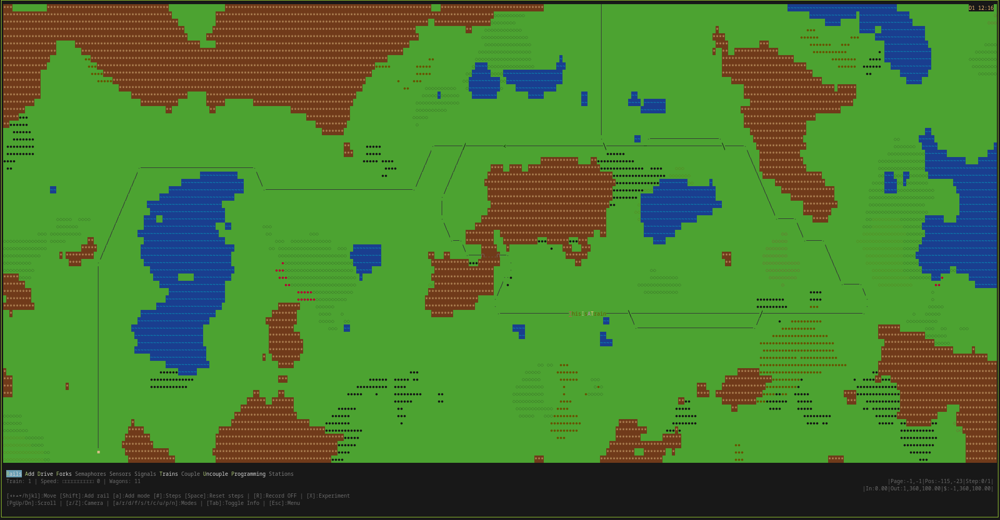
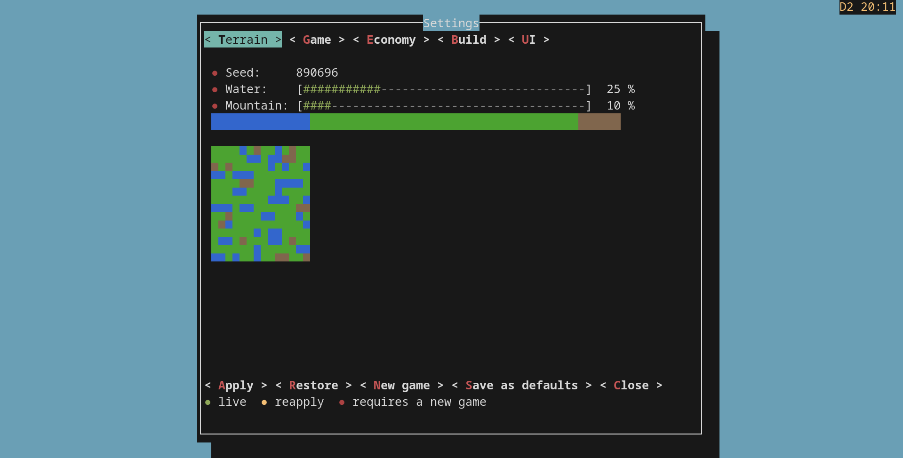
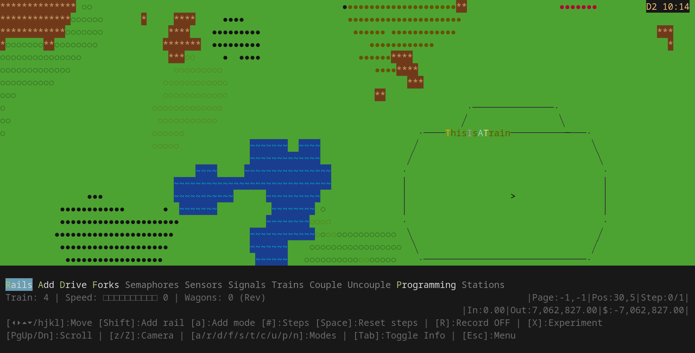
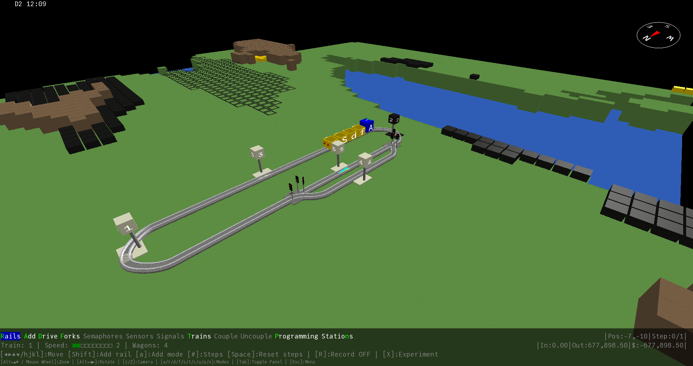
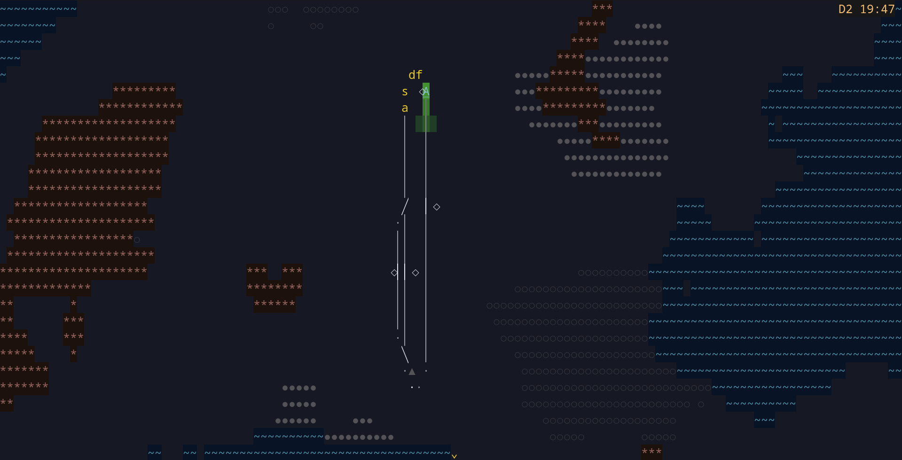
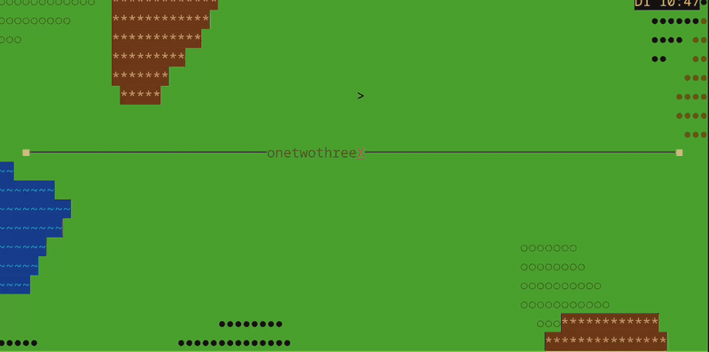
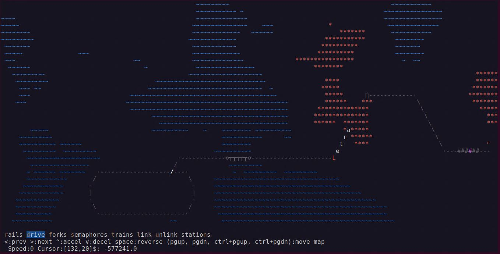
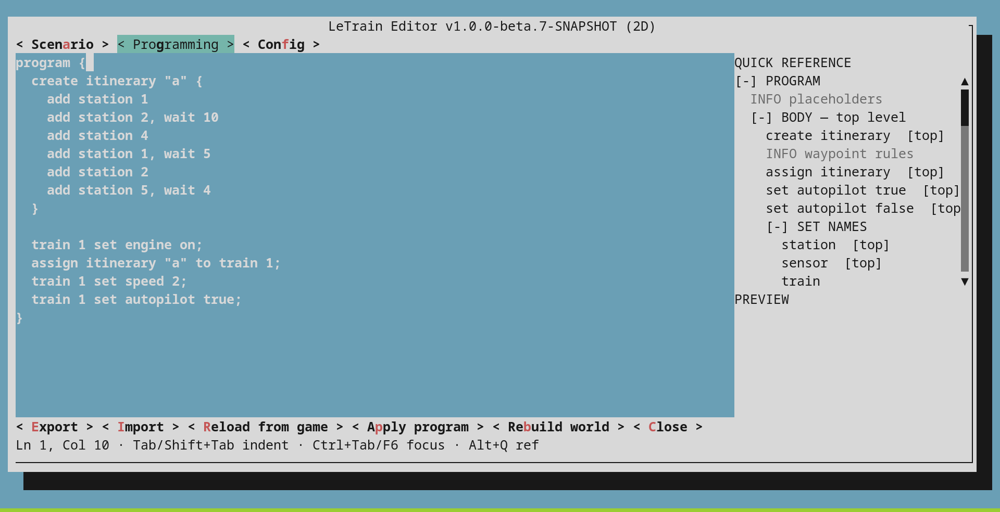

<a name="readme-top"></a>

<p align="left">
  🌐 <a href="README.md">English</a> | <strong>Español</strong>
</p>

[![CI][ci-shield]][ci-url]
[![Contributors][contributors-shield]][contributors-url]
[![Forks][forks-shield]][forks-url]
[![Stargazers][stars-shield]][stars-url]
[![Issues][issues-shield]][issues-url]
[![Apache 2.0 License][license-shield]][license-url]

```
     __       ______           _
    / /   ___/_  __/________ _(_)___
   / /   / _ \/ / / ___/ __ `/ / __ \
  / /___/  __/ / / /  / /_/ / / / / /
 /_____/\___/_/ /_/   \__,_/_/_/ /_/
      The Letter Train Simulator
  (C) 2006-2026 Antonio Vazquez Araujo
```

<!-- PROJECT LOGO -->
<br />
<div align="center">

<h1 align="center">LeTrain</h1>

  <p align="center">
    LeTrain es un simulador de trenes procedural con un cliente clásico de terminal ASCII y un cliente 3D moderno
    <br />
    <a href="https://antoniovazquezaraujo.github.io/LeTrain/"><strong>Explora la documentación »</strong></a>
    <br />
    <br />
    <a href="https://github.com/antoniovazquezaraujo/LeTrain/releases/latest">Descargar</a>
    ·
    <a href="https://avaraujo.itch.io/letrain-procedural-tycoon">Juega en itch.io</a>
    ·
    <a href="https://snapcraft.io/letrain">Snap Store</a>
    ·
    <a href="https://github.com/antoniovazquezaraujo/LeTrain/issues">Reportar un fallo</a>
    ·
    <a href="https://github.com/antoniovazquezaraujo/LeTrain/issues">Pedir una mejora</a>
  </p>
</div>


<!-- TABLE OF CONTENTS -->
<details>
  <summary>Tabla de contenidos</summary>
  <ol>
    <li>
      <a href="#about-the-project">Sobre el proyecto</a>
      <ul>
        <li><a href="#built-with">Hecho con</a></li>
      </ul>
    </li>
    <li>
      <a href="#getting-started">Empezando</a>
      <ul>
        <li><a href="#prerequisites">Requisitos</a></li>
        <li><a href="#installation">Instalación</a></li>
        <li><a href="#configuration">Configuración</a></li>
      </ul>
    </li>
    <li>
      <a href="#usage">Uso</a>
      <ul>
        <li><a href="#economy">Economía</a></li>
      </ul>
    </li>
    <li><a href="#known-issues">Problemas conocidos</a></li>
    <li><a href="#roadmap">Hoja de ruta</a></li>
    <li><a href="#contributing">Contribuir</a></li>
    <li><a href="#license">Licencia</a></li>
    <li><a href="#contact">Contacto</a></li>
  </ol>
</details>


# Aviso: contenido generado por un humano

Hola. Soy Antonio, el autor de LeTrain. La versión anterior de este fichero la escribieron agentes de IA. Un comentario en Hacker News me hizo ver que no era buena idea.
Me di cuenta de que el «ME» de «README» no se refiere al fichero, sino al autor del proyecto.
El primer contacto con un proyecto no puede ser solo información técnica —para eso están los manuales y los tutoriales—; tiene que ser una invitación a hablar, una presentación humana. No puede dar la impresión de que no hay nadie al volante (que es lo que está pasando últimamente con muchos proyectos nacidos de una semana de «vibe-coding»).

LeTrain lleva en mi cabeza desde 2006; la primera versión fue en C, en 2007 lo pasé a C++ y en 2018 a Java. Todas las ideas, mecanismos, algoritmos y bugs son mi responsabilidad. Y después de años viéndolo crecer, ahora veo que todo en él refleja de verdad mi estilo, mi forma de ver las cosas y mi personalidad.
He aprendido de él cada día desde entonces, y todavía me queda mucho por aprender.

En marzo de 2026 empecé a usar IA —como todo el mundo (bueno, excepto ese 1% de programadores humanos que siguen siendo mejores que los LLM :-D)—. Uso OpenCode como arnés y monté un equipo de agentes especializados en cada parte del proyecto. Les puse nombres humanos, en concreto los de la gente de mi equipo de cuando trabajaba en Imatia, quizá para no echarles de menos o quizá para cambiar lo menos posible mi forma de trabajar. Dani es el coordinador, Alex es el experto en Java, Jorge es un crack de la UI, y a Bicho me lo inventé: es el experto en testing.

Les hablo como si fueran personas, o como si fueran «personas de silicio». La verdad es que muestran mucha responsabilidad y hasta buen sentido del humor. A veces discutimos; a veces les corrijo yo, y otras veces me corrigen ellos. Sinceramente, no siento que esté perdiendo el control del proyecto. Al final, sigo siendo yo el que toma cada decisión importante, y sigo sabiendo lo que quiero (y lo que no quiero).

Pero es verdad que ya no escribo código fuente —al menos no Java— y no lo reviso línea a línea. Lo que reviso es el producto y su comportamiento. Pasé de ser el «hombre para todo» del proyecto a ser el arquitecto. En realidad, antes también confiaba en el compilador; no revisaba el bytecode que generaba. Es cierto que la IA puede ser impredecible a veces y crear auténticos monstruos, por eso es importante tener una buena red de seguridad, asegurarse de que todo está probado y, sobre todo, que la base sobre la que trabajamos es sólida y clara. Es en lo que me he centrado todos estos años: todo está separado, se usan patrones de programación estándar y el código era muy claro. Con eso, una IA o un humano pueden hacer cambios, mejoras y añadidos sin miedo a romper nada.

Pero ese comentario me hizo ver el valor de ser humano. Aunque no escribo muy bien y mi inglés necesita Deep Translator, la gente valora más la información cuando viene de otro ser humano. No nos gusta sentir que «hablamos con una tostadora».

Seguiré trabajando en equipo con mis «amigos invisibles» para mejorar el proyecto, pero también aceptaré encantado la ayuda de otras personas. Prometo responder personalmente y no esconderme detrás de jerga técnica.

Ahora, aquí está el viejo `README`, actualizado al estado actual. Si quieres saber por qué existe todo esto, el [manifiesto](docs/PHILOSOPHY_es.md) lo cuenta con más calma.

Antonio.

<!-- ABOUT THE PROJECT -->
<a name="about-the-project"></a>
## Sobre el proyecto
LeTrain es un simulador de trenes procedural con un cliente clásico de terminal ASCII y un cliente 3D moderno. Consiste en crear vías y estaciones por un mapa prácticamente infinito, crear trenes y ganar dinero transportando carga (oro, carbón y rubí) entre productores y consumidores. Cuanto más separados estén, más rentable será.

**Aviso**
Esta es una versión preliminar. Todavía quedan muchas cosas pendientes. Ahora mismo funciona, pero algún día será mucho mejor de lo que es hoy.



<p align="right">(<a href="#readme-top">volver arriba</a>)</p>


<a name="built-with"></a>
### Hecho con
* Java OpenJDK 17
* [Librería Lanterna](https://github.com/mabe02/lanterna) (cliente 2D de terminal)
* [LibGDX](https://libgdx.com/) (cliente 3D)
* ANTLR4 (lenguaje de scripting para automatizar la red)
* Motor de síntesis de audio granular

<p align="right">(<a href="#readme-top">volver arriba</a>)</p>

<!-- GETTING STARTED -->
<a name="getting-started"></a>
## Empezando

<a name="prerequisites"></a>
### Requisitos

* Java JDK 17
* Apache Maven

<a name="installation"></a>
### Instalación
Si no quieres compilarlo, la última versión publicada está en [GitHub](https://github.com/antoniovazquezaraujo/LeTrain/releases/latest), y también hay versiones en [itch.io](https://avaraujo.itch.io/letrain-procedural-tycoon) y en la [Snap Store](https://snapcraft.io/letrain).

Para instalarlo:
* Clónalo
   ```sh
   git clone https://github.com/antoniovazquezaraujo/LeTrain.git
   ```
* Compílalo
	```sh
	mvn clean package -DskipTests
	```
* Ejecútalo
	```sh
	output/LeTrain/bin/LeTrain.sh      # 3D
	output/LeTrain2D/bin/LeTrain2D.sh  # terminal 2D
	```

<a name="configuration"></a>
### Configuración
LeTrain lee `letrain.cfg`, que se distribuye junto al lanzador. Puedes editarlo a mano para cambiar costes, recompensas, la duración del día y otros ajustes. Un `letrain.cfg` en el directorio de trabajo tiene prioridad sobre el que viene empaquetado.

También puedes cambiar casi todo desde el diálogo **Settings** del juego (File → Settings). Algunos cambios se aplican al momento, otros piden reaplicarlos y unos pocos necesitan una partida nueva; el propio diálogo te dice cuáles son. Si exportas un escenario, su bloque `configuration { ... }` viaja con él y gana sobre el `letrain.cfg` local, así que el mapa se juega con las mismas reglas para todos.



<p align="right">(<a href="#readme-top">volver arriba</a>)</p>

<!-- USAGE EXAMPLES -->
<a name="usage"></a>
## Uso

<a name="economy"></a>
### Economía
Empiezas con $0. No es un bug: la idea es construir algo de la nada, y a mí me gusta así. El mapa tiene productores (minas) y consumidores (ciudades y fábricas), y ganas dinero llevando carga (oro, carbón y rubí) de unos a otros. Una estación de carga junto a una mina llena los vagones; una estación de descarga junto a una ciudad o una fábrica los vacía y te paga.

Cuanto más lejos viaja la carga, más paga. Pero la distancia también cuesta: cada metro que avanza el tren quema combustible, y los puentes y túneles son mucho más caros que la vía normal. Una ruta larga puede ser muy rentable o arruinarte, según cómo la construyas.

Puedes ajustar los precios y recompensas base en `letrain.cfg`, o poner tus propios valores en un escenario para que las reglas viajen con el mapa. El número de la esquina inferior derecha del menú es tu saldo.

### Suelo, agua y montañas
Este es el aspecto general de LeTrain. En el mapa, generado aleatoriamente en cada partida, puedes ver el agua en azul, los campos en verde y las montañas en marrón. Construir vías sobre suelo normal es rápido y barato; en cambio, crear puentes para cruzar lagos o perforar túneles para cruzar montañas es lento y caro.



En la parte inferior puedes ver el menú, donde se seleccionan los distintos modos de juego, que te permitirán crear vías, construir vagones y locomotoras, agujas, señales de velocidad, semáforos y sensores.

Cada opción se activa con la letra que aparece en otro color; por ejemplo, para entrar en el modo «drive» pulsa la tecla «d».

Para crear vías en el mapa, selecciona el modo «rails» y muévete con el cursor. Manteniendo pulsada la tecla shift se generan vías, y con control puedes borrarlas. Las agujas y los cruces se crean automáticamente.

Cuando tengamos vías, solo hay que ir al modo «trains», que nos permitirá crear vagones (cualquier letra minúscula) y locomotoras (cualquier letra mayúscula).
**Para salir de este modo hay que pulsar Enter**.

Las teclas son las mismas en ambos clientes; el cliente 3D añade ratón y controles de cámara para el zoom y la vista.

Este es el mismo mundo en el cliente 3D:




#### Día y noche
El juego tiene un reloj, y la luz cambia con él. De noche la paleta se vuelve más oscura y la locomotora de cabeza ilumina la vía con sus faros.



### Enlazar y desenlazar
Al crear vagones y locomotoras no forman un tren: están desenlazados. Para crear un tren hay que tener la locomotora junto a ellos y seleccionar «link», y después con las teclas verticales, elegir la dirección en la que buscar vagones y con las horizontales seleccionar cuántos elementos deseas enlazar. Luego, con la barra espaciadora, enlazarás los vagones seleccionados. Eso será un tren. Para desenlazar vagones, selecciona «unlink», elige la dirección y avanza o retrocede hasta el vagón donde quieras cortar. Después usa la barra espaciadora.



### Mapa infinito
Si sacas el cursor de la página, verás que el mapa continúa. No hay límite salvo la memoria.

Si el cursor te parece demasiado lento, puedes escribir un número antes de usarlo y cada paso se sumará a ese número de pasos. Por ejemplo, si escribes 30, cada vez que pulses la tecla de avance avanzarás 31 pasos: el paso por defecto más los otros 30. (Si eres usuario de Vim -saludos, Bram, donde quiera que estés- te sonará este tipo de cuantificador). Para volver al cuantificador por defecto, usa la barra espaciadora.



### Comportamiento programable
Todo se puede programar, normalmente a partir de eventos —como un tren que pasa por una estación o activa un sensor— y se pueden ejecutar acciones como consecuencia: enganchar vagones, arrancar el tren, cargar mercancía, mover agujas o cambiar señales.



### El editor
Pulsa `p` para abrir el editor de LeTrain. Tiene tres pestañas: **Scenario** (la semilla, la construcción inicial y el estado de arranque), **Programming** (el programa de automatización) y **Config** (los ajustes del juego). A la derecha tienes una referencia rápida de la pestaña activa, y si algo está mal, la lista de errores te lleva a la línea.

Desde el editor puedes exportar e importar escenarios `.ltr`, recargar el mundo actual, aplicar el programa o reconstruir el mundo desde el escenario. `Esc` lo cierra. Guardar y cargar están en el menú File del juego, no en el editor.

### Grabación, deshacer y experimento

Mientras construyes, `R` (`Shift+R`) activa el modo de grabación/edición: el mundo se congela, construyes al instante y cada edición queda en un diario. `u` deshace la última edición y `Ctrl+R` la rehace. `X` (`Shift+X`) activa el modo experimento: toma una instantánea, te deja probar cualquier cosa y la restaura al salir.

En el modo TRAINS, las letras mayúsculas crean locomotoras, así que `X` y `R` crean una locomotora con esa letra en lugar de activar esos modos.

### Guardar la partida
Puedes guardar la partida en cualquier momento, pero hay una excepción: si un tren está en medio de una carga, descarga o espera, la acción pendiente no se guarda. Deja que termine primero. Hay dos ficheros distintos, y merece la pena saber cuál necesitas.

El primero es el savegame, un fichero `.json` con el estado actual del mundo: dónde están los trenes, qué llevan, cuánto dinero tienes y qué hora es. Cárgalo y continúas exactamente donde lo dejaste.

El segundo es el escenario, un fichero `.ltr` de texto plano. No es una foto de la partida, sino la receta para reconstruirla: la semilla del mapa, los ajustes del juego, las vías y estaciones que construiste, el estado inicial y el programa que automatiza la red. La misma semilla y los mismos comandos dan el mismo mundo, así que puedes compartirlo con otra persona, abrirlo en cualquier editor de texto (o en el editor de LeTrain) y comprobarlo con `letrain-check` antes de cargarlo.

Usa `save` y `load` para los savegames, y `export` e `import` para los escenarios. Uno guarda la partida tal y como está; el otro guarda la receta para construirla de nuevo.

### Zoom
En 2D, puedes usar las teclas de zoom de la consola para ver más o menos paisaje cuando lo necesites. Normalmente están asignadas a ctrl-+ y ctrl--.
También puedes usar PgUp y PgDn para moverte arriba y abajo por páginas, o ctrl+PgUp y ctrl+PgDn para moverte horizontalmente entre páginas.

En 3D, la cámara se puede orientar con `Alt+hjkl/flechas` y con la rueda del ratón.

#### No te pierdas
Con un mapa grande es fácil perderse; para volver, cambia al modo «drive» y selecciona con las flechas la locomotora siguiente o anterior. Lo mismo con agujas, estaciones, sensores, etc. También puedes seleccionar objetos por su número: escribe el número y el objeto quedará seleccionado.

Además, si quieres colocar el cursor inmediatamente en la posición de un objeto —una aguja, una estación, un tren, un semáforo, etc.—, pulsa simplemente la tecla `o` para recolocarlo.


### Choque de trenes
En efecto: si dos trenes se acercan a una velocidad de 5 o más, se producirá una catástrofe. Perderás el dinero que te ha costado crearlos. El dinero es el número de la esquina inferior derecha del menú. Baja cuando los trenes se mueven y cuando se construyen vías. Sube cuando los trenes descargan mercancía en una estación consumidora.


 _Para más ejemplos, consulta la [Documentación](https://antoniovazquezaraujo.github.io/LeTrain/)._

<p align="right">(<a href="#readme-top">volver arriba</a>)</p>

<!-- KNOWN ISSUES -->
<a name="known-issues"></a>
## Problemas conocidos

El paquete Snap es cómodo, pero está enjaulado y eso da problemas en algunos entornos. En WSL2 se ejecuta sin sonido, porque no puede acceder al socket de PulseAudio que expone Windows. En XRDP o VNC, el cliente 3D normalmente falla con un error de OpenGL (`Failed to create context: BadValue`), y el cliente 2D no puede enviar audio por la sesión remota.

Si estás en uno de esos casos, usa el zip de Linux (el lanzador `.sh`) o compílalo desde el código fuente. En Windows, el `LeTrain-Windows.zip` de la [página de releases](https://github.com/antoniovazquezaraujo/LeTrain/releases/latest) es la mejor opción. Si encuentras otro problema, abre una issue y cuéntamelo.

<p align="right">(<a href="#readme-top">volver arriba</a>)</p>

<!-- ROADMAP -->
<a name="roadmap"></a>
## Hoja de ruta

Hay muchas cosas por hacer, pero de momento funciona.
- [ ] Añadir trenes de pasajeros y ciudades
- [ ] Terminar el sonido de tren basado en eventos (en revisión)
- [ ] Añadir sonidos de tren grabados profesionalmente: locomotoras, vagones y estaciones reales
- [ ] Añadir inspección, mantenimiento y averías de vía
- [ ] Añadir limpieza, mantenimiento y averías de trenes

Consulta las [issues abiertas](https://github.com/antoniovazquezaraujo/LeTrain/issues) para ver la lista completa de propuestas (y problemas conocidos).

<p align="right">(<a href="#readme-top">volver arriba</a>)</p>

<!-- CONTRIBUTING -->
<a name="contributing"></a>
## Contribuir

Si quieres ayudar, lee primero [CONTRIBUTING.md](CONTRIBUTING.md): explica el build, los tests y el flujo de ramas/PR.

Si tienes una idea, abre una issue. Si quieres arreglarla tú, haz un fork, crea una rama y manda una pull request. Y si simplemente te gusta el proyecto, una estrella ayuda.

<p align="right">(<a href="#readme-top">volver arriba</a>)</p>


<!-- LICENSE -->
<a name="license"></a>
## Licencia

Distribuido bajo la Licencia Apache 2.0. Consulta `LICENSE` para más información.

<p align="right">(<a href="#readme-top">volver arriba</a>)</p>


<!-- CONTACT -->
<a name="contact"></a>
## Contacto


Antonio Vázquez Araújo

Twitter/X - [@avaraujo](https://twitter.com/avaraujo)

Gmail - antoniovazquezaraujo@gmail.com

Enlace del proyecto: [https://github.com/antoniovazquezaraujo/LeTrain](https://github.com/antoniovazquezaraujo/LeTrain)

<p align="right">(<a href="#readme-top">volver arriba</a>)</p>

<!-- MARKDOWN LINKS & IMAGES -->
<!-- https://www.markdownguide.org/basic-syntax/#reference-style-links -->
[ci-shield]: https://img.shields.io/github/actions/workflow/status/antoniovazquezaraujo/LeTrain/ci.yml?style=for-the-badge
[ci-url]: https://github.com/antoniovazquezaraujo/LeTrain/actions/workflows/ci.yml
[contributors-shield]: https://img.shields.io/github/contributors/antoniovazquezaraujo/LeTrain.svg?style=for-the-badge
[contributors-url]: https://github.com/antoniovazquezaraujo/LeTrain/graphs/contributors
[forks-shield]: https://img.shields.io/github/forks/antoniovazquezaraujo/LeTrain.svg?style=for-the-badge
[forks-url]: https://github.com/antoniovazquezaraujo/LeTrain/network/members
[stars-shield]: https://img.shields.io/github/stars/antoniovazquezaraujo/LeTrain.svg?style=for-the-badge
[stars-url]: https://github.com/antoniovazquezaraujo/LeTrain/stargazers
[issues-shield]: https://img.shields.io/github/issues/antoniovazquezaraujo/LeTrain.svg?style=for-the-badge
[issues-url]: https://github.com/antoniovazquezaraujo/LeTrain/issues
[license-shield]: https://img.shields.io/badge/License-Apache_2.0-blue.svg?style=for-the-badge
[license-url]: https://github.com/antoniovazquezaraujo/LeTrain/blob/main/LICENSE
