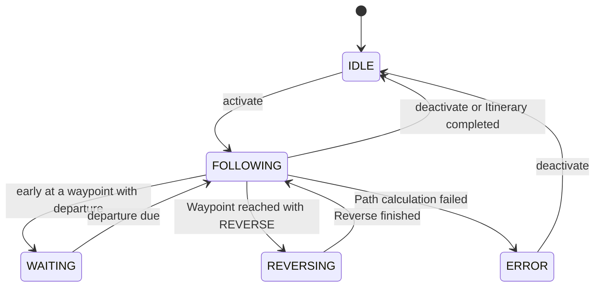
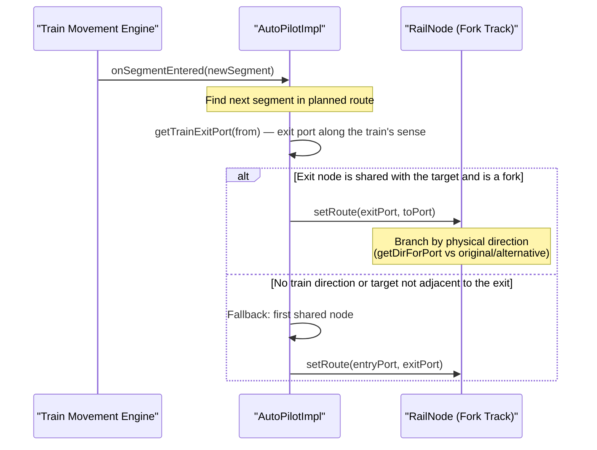

# AutoPilot System Analysis - LeTrain

This document provides a comprehensive analysis of the **AutoPilot** system in LeTrain, detailing its architecture, state machine, interactions, and integration with the safety and routing engines.

---

## 1. Overview & Core Responsibility

The `AutoPilot` system is responsible for autonomously driving a train along a defined sequence of destinations called an `Itinerary`. The itinerary consists of multiple `Waypoint`s (such as Stations or Sensors) containing list of `WaypointCommand`s (e.g., loading, unloading, reversing, or waiting).

Unlike periodic physics systems that poll the entire world, the LeTrain autopilot is designed to be **reactive** and **event-driven**. It calculates path segments lazily, sets fork routes on the fly, and collaborates closely with the safety manager to handle exclusive block reservation.

```mermaid
graph TD
    Train["Train Core Engine"] -->|events (onSegmentEntered)| AutoPilot["AutoPilot"]
    AutoPilot -->|1. Calculate Route| Pathfinder["AStarPathfinder"]
    AutoPilot -->|2. Align Switches| RailNode["RailNode / Fork Track"]
    AutoPilot -->|3. Delegate Actions| ActionManager["TrainActionManager"]
    AutoPilot -. "Cooperates for safety" .-> SafetyManager["TrainSafetyManager"]
```

---

## 2. Interface Contracts & Operational Modes

The `AutoPilot` interface (`core/src/main/java/letrain/itinerary/AutoPilot.java`) defines the contract, and `AutoPilotImpl` implements it.

### Public API Methods
*   `setItinerary(Itinerary)`: Assigns an itinerary and resets index and route.
*   `activate()`: Transitions from `IDLE` to `FOLLOWING` if a valid itinerary is assigned.
*   `deactivate()`: Stops the autopilot, returning the train to manual mode.
*   `onSegmentEntered(Segment)`: Triggered reactively when the train enters a new logical segment.
*   `ensureForkRoute(Segment from, Segment to)`: Orients the fork at the train's **exit port** of `from` (direction-aware) so the switch it is approaching selects the branch that leads to `to`; falls back to the first shared node only when there is no train/direction. See [[../adr/ADR-033-Fork-Orientation-Parallel-Loops|ADR-033]].
*   `replaceRouteSegment(Segment old, Segment new)`: Modifies the planned route dynamically (e.g., during live rerouting or bypasses).

### Operational Modes (`AutoPilot.Mode`)

The autopilot transitions through five distinct states:

| Mode | Description |
| :--- | :--- |
| **`IDLE`** | Autopilot is inactive or has finished its itinerary. Control is manual. |
| **`FOLLOWING`** | The train is moving towards the current waypoint following a calculated list of `Segment`s. |
| **`WAITING`** | The train is held at a waypoint until its scheduled `departure` (retention). `wait N` does **not** use this mode: it is a `TrainActionManager` action (see §5.C and [[../adr/ADR-032-Wait-Stops-The-Train|ADR-032]]). |
| **`REVERSING`** | The train is executing a `REVERSE` command, changing direction and updating safety blocks. |
| **`ERROR`** | An unrecoverable routing error has occurred (e.g., path not found to next waypoint). |

---

## 3. State Machine & Transitions

The following state machine details how the autopilot transitions between different operational modes:



---

## 4. Key Routing & Alignment Mechanics

### A. Lazy Route Calculation (`calculateRoute()`)
When activated, or when the train enters a segment not present in the current cached route, the autopilot requests a path from the `SegmentPathfinder`:
1.  **Current Segment**: Derived from the train's head physical track position.
2.  **Target Segment**: Derived from the coordinates of the target station or sensor specified in the current waypoint.
3.  **Path Search**: Runs the A* algorithm (`AStarPathfinder`) seeking a sequence of `Segment`s. The search respects the waypoint's preferred `entryDir` constraint.
4.  **Failure**: If no path is found, the system logs a warning, and the autopilot stops or triggers a retry cooldown.

### B. Reactive Fork Switch Alignment (`ensureForkRoute`)

The autopilot must set the switch **the train is approaching**, not just any node shared by the
two segments. This is executed reactively inside the `onSegmentEntered(Segment newSegment)` event
handler:



Why direction matters:

*   **Parallel segments share both ends.** With S0/S1/S2 between the same two forks, the *first*
    shared node may be the one the train already left behind. Orienting it is a no-op for the
    transition and the train keeps the old branch. `getTrainExitPort(from)` returns the port the
    train will actually take, so the fork ahead is the one configured.
*   **The exit fork is oriented on segment entry**, which also covers loops where the train enters
    one end of a middle segment (e.g. S1) and leaves through the other.
*   **Normal/alternative by physical branch**, not by port name: `RailNodeImpl.setRoute` /
    `isRouteActive` / `getActiveExit` compare `getDirForPort(exit.getType())` with the fork's
    **live** `originalRoute`/`alternativeRoute`. Port A/B remain a fixed physical mapping built by
    `initializePorts`; they are not re-labelled. A crossed A/B mapping therefore still selects the
    branch that physically leads to the target.
*   **Fallback:** the historical first-shared-node selection is kept only for calls without a
    usable train direction (synthetic/manual) or when `to` is not adjacent to the exit end.

Regression tests: `RailNodeImplRouteTest` (crossed A/B) and `ForkLoopOrientationTest` (triple
parallel loop, including the `1→2→4→1→2→5` itinerary). Full analysis:
[[../adr/ADR-033-Fork-Orientation-Parallel-Loops|ADR-033]].

---

## 5. Integration with other Systems

The autopilot operates at the intersection of several crucial subsystems:

### A. Pathfinder (`SegmentPathfinder`)
The `AutoPilot` utilizes `AStarPathfinder` (`core/src/main/java/letrain/itinerary/AStarPathfinder.java`) to find segment paths. The search is heavily constrained:
*   **Physical Track Cost**: Pathfinding does not just minimize segment count; it queries the graph for track count (`getTrackCount(Segment)`) to prefer shorter physical paths.
*   **Directional Constraints**: It respects the waypoint's `entryDir` (if defined), ensuring the train arrives in the correct orientation.

### B. Safety Engine (`TrainSafetyManager`)
The safety manager operates reactively during movement:
*   When the train enters a fork, the `TrainSafetyManager` locks the next segment ahead and triggers emergency braking if the segment is occupied.
*   The autopilot assists by aligning forks beforehand using `ensureForkRoute`, ensuring the train safety manager's look-ahead calculations correspond to the path the train will actually take.

### C. Action Engine (`TrainActionManager`)
The `TrainActionManager` (`core/src/main/java/letrain/itinerary/impl/TrainActionManager.java`) handles waypoint arrival and command execution:
1.  **Arrival Check**: In every tick, it checks if the train is at the target waypoint.
2.  **Commands**: Upon arrival, it pulls the commands defined in the waypoint:
    *   `LOAD`/`UNLOAD`: Triggers station cargo transfer.
    *   `WAIT`: `wait N` **stops the train and waits**. If the train is moving, it brakes first (deferred like `load`/`unload`), then waits `N` simulation seconds (`N × 20` ticks) and restores the saved speed/plan cruise; `wait 0` is a no-op and a negative count is rejected with a visible notice. It is **not** the autopilot `WAITING` mode (that is the `departure` retention). See [[../adr/ADR-032-Wait-Stops-The-Train|ADR-032]].
    *   `REVERSE`: Initiates direction reversal, which resets safety manager locks.
3.  **Advance**: Once all commands are executed, it advances the waypoint index, clears the old route, and transitions the autopilot back to `FOLLOWING`.

---

## 6. Serialization & State Persistence

To support game saving and loading, the autopilot state is serialized using a Jackson mix-in class named `AutoPilotMixin` (`core/src/main/java/letrain/mvp/impl/AutoPilotMixin.java`).

*   **Serialized Fields**:
    *   `itinerary`: The complete itinerary definition.
    *   `mode`: The current operational mode name.
    *   `currentIndex`: The index of the active waypoint.
    *   `waitTicks`: legacy field kept for savegame compatibility; the active schedule hold is re-armed from the waypoint's `departure` on load.
    *   `pendingCommands`: List of commands that are queued for execution at the active waypoint.
*   **Deserialization**: Jackson rebuilds the `AutoPilotImpl` using a specialized constructor, which is later reconnected to the live `Train` and `TrainActionManager` references via `reinitialize(Train, TrainActionManager)`.

---
*Document prepared on 2026-06-09 by Dani (Coordinador)*
